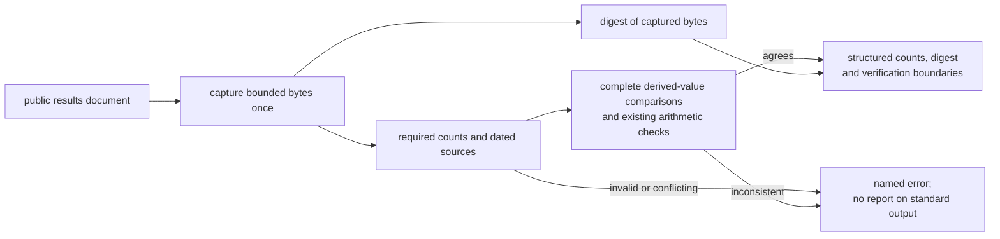

# A reproducible report of the public evidence

Use the evidence report when a notebook, reviewer or documentation workflow needs exact public
counts and their source identity without scraping terminal formatting. It is a read-only audit of
this write-up's aggregate table. It does not connect to or execute the private platform.

## Run it

Python with its standard library is sufficient. From a clone:

```bash
python3 scripts/evidence_report.py
```

The default input is [results.md](results.md), resolved relative to the program rather than the
calling directory. Successful output is one json object on standard output; exit status is zero.
Its stable schema is `qts-public-evidence/v1`. An excerpt:

```json
{
  "arithmetic_verified": true,
  "source_data_verified": false,
  "operational_health_verified": false,
  "stored_rows": {
    "ashare_cleansed": 565949690871,
    "crypto_stored": 138059600559,
    "total": 704009291430,
    "source_date": "2026-10-05",
    "distinct_count": null
  },
  "concurrency_reads": {
    "total": 1111,
    "source_date": "2026-09-23"
  }
}
```

The complete result also includes each source reference, the document name, a digest of its
exact bytes and explicit limits. There is no execution timestamp in the result: the same document
produces the same report. Keep the digest with the study or review record. A later editorial
change produces a different digest even when the numeric values remain unchanged.

## Input and failure contract

To audit an edited copy of the public report:

```bash
python3 scripts/evidence_report.py --results edited-results.md
```

The file must use the existing raw-count, headline, scale and concurrency tables. Each section
and each aggregate row used by the arithmetic must appear exactly once. This is a
specific public-evidence format, not a parser for arbitrary market-data files. The input limit is
524288 bytes. Count cells accept nonnegative decimal integers, with correctly grouped commas,
up to 9223372036854775807 and at most nineteen digits after removing commas. Required count
names must appear once each. Source references require a nonempty name and valid date. Counts
contributing to one result must name the same dated source, and the corresponding headline/result
must name that source too. Percentage denominators
must be nonzero; the typed count must cover the cleansed count.
Rows are checked across the complete section, including later or indented tables after prose.
Both cleansing-removal count references must agree with their contributing raw counts. The scale
row requires exactly one citation each for counts, day ranges and the exact-duplicate rule; its
`(counts)` reference identifies the contributing count snapshot, while the other named citations
retain their own dates. Raw counts
remain one declared count set under a three-cell header; another header or count table is refused.
Indented and fenced code examples cannot start/end sections or contribute table rows. Heading and
fence recognition follow the relevant [CommonMark definitions](https://github.com/commonmark/commonmark-spec/blob/0.31.2/spec.txt).
The report accepts the declared heading and pipe-table format; it does not provide a general Markdown renderer.
The original bytes bind the digest. The arithmetic reader receives a deterministic view of that
same captured input with literal code examples excluded and accepted headings normalized; it
never rereads the caller's file. Derived Result cells, the rounded stored-row Measure and the
threshold-calculation paragraph use the canonical wording in [results.md](results.md), with
their complete values recomputed from the raw counts. An expected number mentioned as negated,
obsolete or inside other unsupported wording does not count as agreement. Other editorial text
is outside these declared arithmetic fields; the report does not infer truth from free-form prose.

| Failure | Reported code | Recovery |
|---|---|---|
| Missing or unreadable file | `input_read_error` | Supply a readable public document. |
| Temporary snapshot storage cannot be created, written or read | `report_io_error` | Restore writable temporary storage and available space before rerunning. |
| Oversized input or invalid text encoding | `input_too_large` / `invalid_encoding` | Use a bounded utf-8 report; do not truncate evidence silently. |
| Missing, duplicate, unsupported or malformed count | `invalid_counts` | Correct the named table entry against its dated source. |
| Zero denominator or impossible layer relationship | `invalid_count_relationship` | Resolve the input relationship before computing a percentage. |
| Missing source name/date or mixed source snapshots | `inconsistent_sources` | Supply the named source and reconcile its date/reference before combining records. |
| Missing or duplicate aggregate row/section, or a derived statement disagrees with its counts | `inconsistent_arithmetic` | Remove ambiguity and correct the raw input or derived statement, with source provenance. |

Input/report failures emit one json error object on standard error and exit with status one. Standard output
stays empty, so a failed report cannot be mistaken for a usable result. The document is never
changed. Correcting it and running again needs no state reset or partial-output cleanup.
Invalid command-line options use the standard usage message and status two; `--help` prints usage
and succeeds. Preserve integer precision when consuming the report's numeric fields.

Run this bounded normal/failure/recovery example from the clone. It edits only a temporary copy
and prints each result; the published input stays unchanged:

```bash
python3 - <<'PY'
import json
from pathlib import Path
import subprocess
import sys
import tempfile

original = Path("docs/results.md").read_bytes()
incorrect = original.replace(b"704,009,291,430", b"704,009,291,431", 1)
assert incorrect != original
with tempfile.TemporaryDirectory() as directory:
    path = Path(directory) / "results.md"
    for step, content, expected in [("normal", original, 0),
                                    ("incorrect", incorrect, 1),
                                    ("recovered", original, 0)]:
        path.write_bytes(content)
        run = subprocess.run([sys.executable, "scripts/evidence_report.py", "--results", str(path)],
                             capture_output=True, text=True, timeout=10)
        assert run.returncode == expected, run.stderr
        result = json.loads(run.stdout if expected == 0 else run.stderr)
        assert not (run.stderr if expected == 0 else run.stdout)
        if expected == 1:
            assert result["error"]["code"] == "inconsistent_arithmetic"
        else:
            assert result["stored_rows"]["total"] == 704009291430
        print(json.dumps({"step": step, "exit_code": run.returncode, "result": result}, sort_keys=True))
assert Path("docs/results.md").read_bytes() == original
PY
```

The statuses are zero, one and zero. The middle result names `inconsistent_arithmetic`; restoring
the captured document recovers the original total and digest without retaining failed output.

## How the computation works



The implementation compares the complete declared derived fields and reuses the
[existing figure parser and arithmetic](../scripts/figures.py) as an additional check. That checker
accepts a file path, so the program supplies a deterministic view of the captured input, excluding
code examples and normalizing accepted headings. The digest binds the original bytes. This avoids
checking a second read of a caller's file while hashing the first. The temporary view is removed
on success or failure. [Acceptance cases](../tests/test_evidence_report.py) include a
deterministic change to the caller's file between capture and checking; the result remains bound
to the original captured bytes.

The sums are compared with independent integer sums in the tests. Cases cover normal and repeated
runs, editorial digest changes, wrong totals, missing/duplicate counts, conflicting dates,
numeric boundaries, unreadable/invalid/oversized input and correction/recovery. The original
document/privacy checks and their positive/negative controls remain in the full check, which
also runs these report cases. There is no test-count target or new performance claim.

## What verification means

`arithmetic_verified` is a computation on published aggregates. `source_data_verified` and
`operational_health_verified` remain false because the underlying private records and today's
service state were not checked. A matching digest identifies bytes; it does not certify their
truth. Stored rows are not unique rows, and the cleansing-removal source-snapshot reconciliation
remains open. These flags and limits must travel with any downstream display or report.

Use [the researcher workflow](research-workflow.md) for layer/version/gap choices, and the
separately owned [public demo](https://github.com/oscar-chw/qts-platform-demo) for executable
data/version concepts. This report does not establish backtest correctness, trading results or
private-platform capacity.

The current local evidence covers the stated cases on Python 3.9.6 and 3.11. The existing figure
reader can emit a resource warning when called directly under warning-enabled tests; that warning
has not been suppressed or used as a performance claim. Remote evidence on
[the review PR](https://github.com/oscar-chw/qts-platform-showcase/pull/1) must cover the exact
candidate revision being assessed; earlier checks do not cover changed source.
